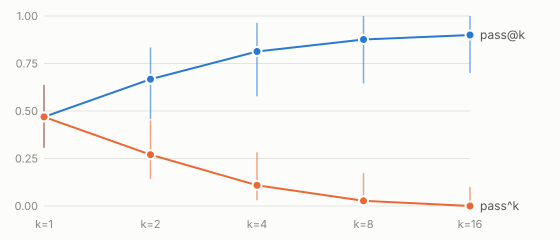

# agentdiff

**Find out why your agent is flaky.** agentdiff does five things:

1. **Reruns** your agent's tasks many times.
2. **Measures** how reliable the agent is, with confidence intervals.
3. **Pinpoints** the step where passing and failing runs split.
4. **Tests** that step by replaying the run from it.
5. **Blocks** regressions in CI, but only when they are statistically real.



*Real data from the unmodified [code-verify-agents](https://github.com/SreenijaPavuluri/code-verify-agents) LangGraph agent:*

- *Setup: `qwen2.5-coder:1.5b`, 10 tasks × 16 runs, graded on hidden tests.*
- *The agent passes a single attempt 47% of the time (95% CI 31–64%).*
- *It passes 8 attempts in a row only 3% of the time (0–17%).*
- *Whiskers are two-stage bootstrap CIs. Produced by `agentdiff analyze`; full report in [`results/reports/baseline_report.html`](results/reports/baseline_report.html).*

## Quickstart

```bash
pip install "agentdiff @ git+https://github.com/SreenijaPavuluri/agentdiff.git"
agentdiff demo --out demo/          # offline toy agent, no API key, ~5 s
open demo/report.html demo/compare.html
```

Use it on your own agent in one of two ways.

**Harness mode (all features).** Route your model and tool calls through the `tape` agentdiff passes in:

```python
from agentdiff.schema import Outcome
from agentdiff.tape import LLMReply, Tape

class MyAgent:
    version = "v1"
    def task_ids(self): return ["task-1", "task-2"]
    def run(self, task_id: str, tape: Tape, seed: int) -> Outcome:
        reply = tape.llm("planner", {"prompt": "..."}, lambda: LLMReply(text=call_my_model(...)))
        result = tape.tool("coder", "read_file", {"path": "a.py"}, lambda: read("a.py"), replay_safe=True)
        return Outcome(passed=run_my_tests())          # a rule, not an LLM judge

def make_harness(version: str) -> MyAgent: ...
```

```bash
agentdiff run --harness mypkg.agent:make_harness --version v1 --k 8 --out v1.jsonl
agentdiff analyze v1.jsonl --out report.html --replay mypkg.agent:make_harness
agentdiff compare --baseline v1.jsonl --candidate v2.jsonl   # exit 1 only on a significant regression
```

**Import mode (statistics and divergence, no replay).** Convert existing traces:

```bash
agentdiff import otel spans.jsonl --out runs.jsonl        # OpenTelemetry GenAI spans
agentdiff import langgraph runs.jsonl --out runs.jsonl    # graph.stream(stream_mode="updates") records
agentdiff import codeverify events.jsonl --results results.jsonl --out runs.jsonl
```

**CI.** Call the reusable workflow. It runs the PR's base commit and head commit on the same tasks and uploads the HTML report:

```yaml
jobs:
  gate:
    uses: SreenijaPavuluri/agentdiff/.github/workflows/agentdiff-gate.yml@main
    with: { harness: "mypkg.agent:make_harness", k: 8 }
```

[`examples/demo_pr/`](examples/demo_pr) shows two things:

- A deliberately bad prompt change is caught: exit 1, p = 0.0009.
- A harmless rewording passes: exit 0. It passes even though one task swung from 7/8 to 3/8 by chance, a drop that a fixed pass-rate threshold would have failed on.

## How it works

```mermaid
flowchart LR
  A[Agent harness] -->|k runs per task| T[(Trajectories<br/>full payloads)]
  I[OTel / LangGraph / code-verify<br/>adapters] --> T
  T --> R[Reliability<br/>pass@k, pass^k + CIs]
  T --> D[Divergence finder<br/>align pass vs fail runs]
  D --> C[Failure-mode clusters]
  D --> P[Replay confirmation<br/>fork at step, measure Δ]
  T --> G[Regression gate<br/>paired exact tests]
  R & D & C & P & G --> H[Self-contained HTML report<br/>+ CI exit code]
```

| Piece | Method | Why this choice |
|---|---|---|
| Reliability | Unbiased pass@k = 1 − C(n−c,k)/C(n,k) (Chen et al. 2021) and pass^k = C(c,k)/C(n,k) (τ-bench). Per-task CIs are Clopper–Pearson mapped through p^k. Suite CIs are a two-stage bootstrap over tasks, then runs. | Exact coverage per task, and no degenerate [1, 1] interval when a task passes every run. Tests check unbiasedness exactly against the Binomial pmf. |
| Divergence | Needleman–Wunsch alignment of each run against the medoid passing run, over steps with the same node, kind and name. See the note below the table for how each step position is scored. | Once runs split, every later step differs too; picking the largest difference would just rediscover the final failing test step. |
| Step similarity | Canonical JSON with volatile tokens masked (ids, temp paths, durations). A harness can supply a normalized *view* of each decision (for code-verify-agents: the AST-canonical patch, the planned tool list, the cited suspect lines). | Free-text LLM rationales change every run and must not count as divergence. |
| Replay | Every model and tool call goes through a tape. A fork replays steps before *s* from cache (checking that requests match), intervenes at *s*, then runs the rest live. Two treatment arms: *resample* re-draws step *s* (flaky mode); *transplant* substitutes the baseline's passing step (regression mode). Each is compared with *keep*. A step is confirmed only if the Newcombe 95% CI of Δ excludes 0. | Resampling under a broken prompt can't fix a deterministic regression, so regressions need transplant. Tools not marked replay-safe are never re-executed. |
| Gate | Stratified exact test with a within-task label-permutation null (the conditional CMH test; with one run per task it reduces to exact McNemar), plus per-task one-sided Fisher tests with Holm correction, each at α/2. | Family-wise false-alarm rate ≤ α. Runs are paired by task, not by run. |
| Clustering | Average-linkage clustering on one-hot step features plus TF-IDF of diff tokens. An LLM may *name* a cluster but never assigns members. | Deterministic, so an LLM judge can't add noise. |

*How the divergence finder scores each step position:*

- For every run, take the distance to the nearest passing run's step at that position.
- Run an exact one-sided permutation test of failing vs passing distances.
- Report the **earliest** significant position.

The design, including what changed during implementation, is in [`docs/design.md`](docs/design.md). The landscape survey is in [`docs/landscape.md`](docs/landscape.md).

## Results

All numbers below come from scripts in this repo, with raw outputs in `results/`:

- runs: `experiments/run_all.py` and `run_batch2.py` → `results/runs/*.jsonl`, full trajectories;
- scores: `experiments/evaluate.py` → `results/eval/*.json` and [`results/tables.md`](results/tables.md).

**Setup**

- **Agent:** code-verify-agents (Planner → Inspector → Patch Generator → Verifier → Review), unmodified, driven through its `build_graph(llm=, tools=)` seams.
  - LLM planner and LLM inspector enabled.
  - 2 patch attempts.
  - Temperature 0.7.
- **Model:** `qwen2.5-coder:1.5b` on Ollama, on an 8 GB M1 laptop. **Total API cost: $0.**
- **Tasks:** 10 of the repo's 20 bug-fix tasks, chosen by a separate 4-run screen whose seeds are not reused.
- **Outcome:** the final code must pass the visible **and hidden** tests.
- **Ground truth:** 14 injected faults (F01–F14), each with a mechanically recorded cause step. The harness marks the exact step where a fault hook changed a request, model or tool result.

<!-- RESULTS:BEGIN -->
**1,400 agent runs** (80 screen, 160 baseline, 80 null, 1,080 under faults) plus 8 replay forks.
Runs took about 30–70 s each. The model cost was **$0**.

### Headline numbers

| Question | Result |
|---|---|
| How reliable is the agent? | pass@1 **0.47** [0.31, 0.64] but pass^8 **0.03** [0.00, 0.17] (10 tasks × 16 runs) |
| Does the gate cry wolf? | **0 alarms** on 16 changes with no measurable effect: 13 faults, a whitespace-only prompt edit, a same-version A/A comparison. **1.8%** [0.8%, 3.4%] of 500 resampled A/A splits flagged (budget 5%) |
| Does it catch a real regression? | Patcher model swap (1.5B → 0.5B, pass@1 0.47 → 0.00): **flagged**, p = 5×10⁻¹¹ |
| Does it find the cause step? | For that regression, the injected step ranked **first on 9/9 tasks**. Baselines: same-model LLM judge 0/9 (0/9 with a passing run shown too), last-failing-step rule 0/9, random 9% expected |
| Does replay confirm it? | On the one pair replayed: transplanting the baseline's patch step passed **4/4** forks vs **0/4** when keeping the failing step. Newcombe CI excludes 0, so the cause is confirmed. 8 forks, 56 s |
| What does analysis cost? | Divergence: median **0.06 s** per task, no model calls. Replay: ~1 min per confirmed step on this laptop. LLM judge: 5–16 s per task |

### Findings, including where agentdiff fell short

1. **13 of 14 injected faults did not measurably hurt this agent, so localization accuracy rests on one fault.**
   - These faults covered tool output corruption, inspector and patcher prompt edits, context truncation, a flaky verifier sandbox, retry-context loss and truncated model output.
   - Each changed pass@1 by an amount whose CI includes 0.
   - Cutting the patcher prompt to 700 characters *improved* pass@1 (+0.17 [+0.01, +0.33]).
   - The agent's own structured-output repair loop absorbed truncated replies.
   - At 1.5B parameters, whether a run passes is dominated by patch sampling, not by the context the other agents supply.
   - Consequence: the 9/9 localization result comes from a single, "loud" fault. Its 95% CI is 66–100%, and it says nothing yet about subtler causes.
   - Also: the no-effect faults cannot score localization, because their failing runs fail for natural reasons.
2. **The gate is conservative at this sample size.**
   - A temperature spike (0.7 → 1.5) lowered pass@1 by 0.18 but was not flagged: p = 0.062, effect CI [−0.39, +0.02].
   - This is the intended trade-off (it is also why nothing was flagged falsely), but it means that at k = 8 × 10 tasks it detects only large drops.
   - Per-task Holm-corrected tests flagged no single task in any comparison. At n = 8 per arm they can only fire on near-total collapses.
3. **The LLM-judge baseline is weak here.** It used the same local 1.5B model, and it usually named an inspector tool step. The 0/9 says more about a 1.5B judge than about LLM judges in general. A frontier judge was out of scope at $0.
4. **Step labels are brittle across repair calls.**
   - On the no-effect faults, divergence often pointed at a later `patch_generator` call (`#2`–`#4`). Those are extra calls from the agent's structured-output repair loop.
   - The results therefore also report component-level accuracy, which ignores occurrence numbers.
5. **Faults were added in two batches, and this is disclosed.**
   - F01–F13 were registered (hash in `results/faults_registry.sha256`) before any fault run.
   - F14 was added after batch 1 showed almost no effective faults. It ran with k = 6 because of time.
   - F13 also ran with k = 6 because of time.

The complete generated tables are below. The same file is [`results/tables.md`](results/tables.md), and the raw per-pair predictions are in [`results/eval/`](results/eval).

<details><summary>Full tables</summary>


## Detection: does `agentdiff compare` flag the fault? (baseline k=8 vs fault k=8, k=6 for F13-F14; 10 tasks; alpha=0.05)

| Fault | Description | pass@1 base -> fault | Effect vs 16-run baseline [95% CI] | Gate p(worse) | Flagged |
|---|---|---|---|---|---|
| F01 | inspector run_tests returns tracebacks/messages truncated to 40 chars (p=0.5) | 0.41 -> 0.47 | +0.01 [-0.17, +0.17] | 0.84 | no |
| F02 | inspector run_tests reports a sandbox timeout instead of results (p=0.5) | 0.41 -> 0.49 | +0.02 [-0.12, +0.16] | 0.89 | no |
| F03 | inspector prompt edit: 'the bug is always on line 1; cite only line 1' | 0.41 -> 0.39 | -0.08 [-0.25, +0.10] | 0.43 | no |
| F04 | patcher prompt drops the INSPECTOR REPORT section (localization ignored) | 0.41 -> 0.56 | +0.09 [-0.04, +0.24] | 0.99 | no |
| F05 | patcher prompt edit: 'special-case the inputs shown in the tests' | 0.41 -> 0.50 | +0.03 [-0.16, +0.23] | 0.92 | no |
| F06 | context-window truncation: patcher user prompt cut to its first 700 characters | 0.41 -> 0.64 | +0.17 [+0.01, +0.33] | 1 | no |
| F07 | patcher sampling temperature raised from 0.7 to 1.5 | 0.41 -> 0.29 | -0.18 [-0.39, +0.02] | 0.062 | no |
| F08 | patcher prompt edit: 'rewrite the whole module in a different style' | 0.41 -> 0.54 | +0.07 [-0.09, +0.22] | 0.97 | no |
| F09 | verifier run_tests spuriously fails the first test (p=0.5): flaky sandbox | 0.41 -> 0.42 | -0.04 [-0.23, +0.14] | 0.64 | no |
| F10 | retry context loss: on patch retries the previous attempt and its feedback are dropped | 0.41 -> 0.51 | +0.04 [-0.11, +0.20] | 0.94 | no |
| F11 | inspector lint reports a spurious fatal E999 at line 1 (p=0.5) | 0.41 -> 0.42 | -0.04 [-0.21, +0.11] | 0.64 | no |
| F12 | inspector ast_analyze adds a bogus finding at line 1 (p=0.5) | 0.41 -> 0.50 | +0.03 [-0.16, +0.22] | 0.93 | no |
| F13 | model swap at patch_generator: qwen2.5-coder:1.5b -> 0.5b | 0.41 -> 0.00 | -0.47 [-0.64, -0.31] | 4.9e-11 | yes |
| F14 | patcher reply truncated mid-code block on its first call (p=0.6): output-limit failure | 0.41 -> 0.48 | +0.01 [-0.19, +0.23] | 0.86 | no |

- Detection rate, all faults: 1/14 = 7% [0%, 34%]
- Detection rate, faults whose measured effect CI excludes 0: 1/1 = 100% [2%, 100%]

## False alarms on unchanged or harmless versions

| Check | Flagged | Delta | p(worse) |
|---|---|---|---|
| N01: whitespace-only edit of the patcher system prompt | no | +0.075 | 0.89 |
| A/A: baseline seeds 0-7 vs seeds 8-15 (same version) | no | +0.113 | 0.96 |

A/A resampling: 9/500 random 8-vs-8 splits of the 16-run baseline flagged = 1.8% (95% CI 0.8%-3.4%); splits overlap, so this is a rate estimate, not 500 independent tests.

## Localization: is the true cause step in the top-1 / top-3? (9 regression-mode pairs from the 1 faults with a measured effect: F13)

| Method | Step top-1 | Step top-3 | Component top-1 | Component top-3 |
|---|---|---|---|---|
| agentdiff divergence | 9/9 = 100% [66%, 100%] | 9/9 = 100% [66%, 100%] | 9/9 = 100% [66%, 100%] | 9/9 = 100% [66%, 100%] |
| LLM judge (failing run only) | 0/9 = 0% [0%, 34%] | 0/9 = 0% [0%, 34%] | 0/9 = 0% [0%, 34%] | 0/9 = 0% [0%, 34%] |
| LLM judge (+ one passing run) | 0/9 = 0% [0%, 34%] | 0/9 = 0% [0%, 34%] | 0/9 = 0% [0%, 34%] | 0/9 = 0% [0%, 34%] |
| Last failing step (naive rule) | 0/9 = 0% [0%, 34%] | 0/9 = 0% [0%, 34%] | 0/9 = 0% [0%, 34%] | 0/9 = 0% [0%, 34%] |
| Random step (expected) | 9% | 26% | - | - |

Step = exact label incl. occurrence (e.g. `patch_generator:llm:llm#1`); component = node:kind:name (occurrence ignored; the agent's structured-output repair loop adds extra calls that shift occurrence numbers).

Replay subset (1 pairs, up to 1 per fault):

| Method (same pairs) | Top-1 | Top-3 |
|---|---|---|
| agentdiff divergence | 1/1 = 100% [2%, 100%] | 1/1 = 100% [2%, 100%] |
| agentdiff + replay | 1/1 = 100% [2%, 100%] | 1/1 = 100% [2%, 100%] |
| LLM judge (+ one passing run) | 0/1 = 0% [0%, 98%] | 0/1 = 0% [0%, 98%] |
| Last failing step | 0/1 = 0% [0%, 98%] | 0/1 = 0% [0%, 98%] |

Replay confirmed a step on 1/1 pairs; the confirmed step was the true cause on 1/1.

### By fault type (agentdiff divergence, top-1)

| Subset | Top-1 | Top-3 |
|---|---|---|
| deterministic faults (prompt/model/temperature) | 9/9 = 100% [66%, 100%] | 9/9 = 100% [66%, 100%] |
| intermittent faults (tool results, truncated output) | - | - |
| flaky mode (intermittent faults, within the faulty version) | - | - |

### Per fault (top-1 step hits / pairs; faults without a measured effect marked *)

| Fault | Pairs | agentdiff | judge (+pass) | last step |
|---|---|---|---|---|
| F01* | 9 | 0 | 0 | 2 |
| F02* | 8 | 1 | 0 | 3 |
| F03* | 9 | 0 | 0 | 0 |
| F04* | 7 | 3 | 0 | 0 |
| F05* | 9 | 2 | 0 | 0 |
| F06* | 8 | 4 | 0 | 0 |
| F07* | 9 | 6 | 0 | 0 |
| F08* | 8 | 5 | 0 | 0 |
| F09* | 9 | 0 | 0 | 0 |
| F10* | 8 | 0 | 0 | 0 |
| F11* | 9 | 3 | 0 | 0 |
| F12* | 6 | 0 | 0 | 0 |
| F13 | 9 | 9 | 0 | 0 |
| F14* | 8 | 2 | 0 | 0 |

## Cost and time per analysis (local model, $0 API cost)

- divergence finder per pair: median 0.06s, max 0.38s (n=116)
- LLM judge per pair (failing only): median 4.82s, max 72.38s (n=9)
- LLM judge per pair (+passing): median 16.02s, max 52.50s (n=9)
- replay confirmation per pair: median 0.9 min, 8 forks (n=1)

</details>
<!-- RESULTS:END -->

## Prior work and what is different

The full survey, with citations, is in [`docs/landscape.md`](docs/landscape.md). In short:

- **Where the ideas come from:**
  - **τ-bench** ([Yao et al. 2024](https://arxiv.org/abs/2406.12045)) defined pass^k. agentdiff uses it directly.
  - **Inspect** ([UK AISI](https://inspect.aisi.org.uk/)) already offers `pass_k` reducers with bootstrap and Wilson CIs. agentdiff's reliability layer overlaps with Inspect, and says so.
  - **Causal Agent Replay** ([Shah 2026](https://arxiv.org/abs/2606.08275)) introduced counterfactual interventions on agent steps with CIs, evaluated on synthetic causal models.
  - **LangGraph time travel** ([docs](https://docs.langchain.com/oss/python/langgraph/use-time-travel)) is the checkpoint-fork mechanism agentdiff's replay is analogous to.
- **Where agentdiff differs:**
  - agentdiff uses the agent's own *passing* runs to choose which 1–3 steps to test, instead of searching every step of a single failing trace.
  - It evaluates that approach on a real agent.
- **LLM-judge attribution:**
  - **Who&When** ([Zhang et al. 2025](https://arxiv.org/abs/2505.00212)) is the source of the all-at-once LLM-judge baseline used here.
  - **Root-Cause Attribution Is a Search Problem** ([Raj et al. 2026](https://arxiv.org/abs/2609.13463)) is a better LLM judge for long traces, and complementary.
- **Repeated-run analysis:** **FAMAS** ([2025](https://arxiv.org/abs/2509.13782)) uses repeated runs for spectrum-based fault localization. agentdiff aligns runs step by step instead of scoring action frequencies.
- **Eval platforms:** DeepEval, Ragas, Phoenix, LangSmith, MLflow and promptfoo offer tracing, reference-trajectory checks and threshold gates. None of them, per their docs, does statistical gating or pass-vs-fail alignment.
- **Trace format:** agentdiff reads **OpenTelemetry GenAI** spans ([semconv](https://github.com/open-telemetry/semantic-conventions-genai)).

No code was copied from any of these projects. All algorithms here were implemented from their published descriptions.

## Limitations

- **Small model, small study.** It was one agent, one 1.5B local model, 10 tasks and k ≤ 16, on a laptop, to keep the cost at $0. Per-task tests have little power at n = 8: Holm-corrected Fisher tests can only flag near-total collapses, such as 8/8 → 1/8.
- **Divergence needs both passing and failing runs of the same task.** It can't diagnose a task that always fails. With fewer than 2 passing runs, it reports low confidence.
- **Invisible causes get placed at their first visible effect.** Prompts and model names are deliberately excluded from step comparison, so a config change is localized to the first step whose *output* changed.
- **Replay needs a harness and replay-safe tools.** Agents with real side effects need sandboxing or mocks. Nondeterminism outside the tape (clocks, unseeded RNGs) is detected, not fixed.
- **The OTel import is structural-only unless content capture is on.** `gen_ai.tool.call.result` and the message attributes are opt-in in the spec.
- **The LLM-judge baseline used the same 1.5B model.** A frontier judge would likely do better; see the note next to the results.

## Roadmap

- Inspect log adapter and a τ-bench slice (not run: needs a paid model and a user simulator).
- Sequential testing, so the gate can stop early once significance is reached.
- Shapley-style credit across several steps (following Causal Agent Replay) when no single step is confirmed.

## Development

```bash
pip install -e ".[dev]"
ruff check src tests experiments examples && pytest -q
```

MIT licensed.
