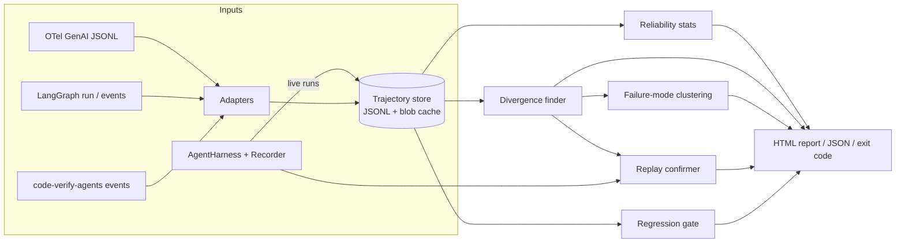

# agentdiff design

Status: **implemented**. This document was written before the build and has been updated where the implementation changed the plan; every change is listed in §12. Numbers here are definitions, not results; results are in `results/tables.md`.

## 1. Goals and non-goals

**Goals**

1. Measure how reliable an agent is on a task suite: pass@1, pass@k and pass^k, each with honest uncertainty.
2. For flaky tasks, and for tasks that regress between versions, find the step where failing runs split from passing runs. Show the evidence side by side.
3. Confirm that a candidate step actually causes the failure. We do this by forking from that step with cached tool observations and measuring how the pass rate changes. The result is a confidence interval, not a verdict from an LLM judge.
4. Gate CI only on statistically significant regressions. We report a measured false-alarm rate.
5. Prove points 2–4 on ground truth: injected faults whose cause step is known.

**Non-goals**

- A tracing backend or UI platform. agentdiff reads traces and writes a static HTML report.
- LLM-judge scoring of outcomes. Outcomes come from rules, such as tests passing or answers matching.
- Replaying tools that are not safe to re-run. See §6.4.

## 2. Architecture



Two ways in:

- **Import mode.** Adapters turn existing traces into trajectories. This supports statistics, divergence and gating. Replay is not possible, because the agent itself is not available.
- **Harness mode.** The user implements a small `AgentHarness` protocol (§6.1). agentdiff then runs the agent k times, records every model and tool call with full payloads, and can fork runs. All four capabilities work.

**Package layout (planned)**

```
src/agentdiff/
  schema.py          # Pydantic v2 trajectory model
  adapters/          # otel.py, langgraph.py, codeverify.py
  runner.py          # k-run executor: concurrency, retries, budget
  budget.py          # token/cost accounting, price table, hard stop
  stats/             # estimators.py, intervals.py, tests.py (Fisher, permutation, Newcombe)
  align/             # normalize.py, similarity.py, nw.py (alignment)
  divergence.py      # earliest consistent split
  cluster.py         # failure-mode clustering (deterministic) + optional LLM naming
  replay/            # recorder.py, cache.py, fork.py
  gate.py            # compare + exit codes
  report/            # Jinja2 template -> single self-contained HTML
  cli.py             # Typer CLI: run, analyze, replay, compare, report
integrations/codeverify/   # harness + fault injection for code-verify-agents
experiments/               # evaluation scripts; raw outputs go to results/
```

Dependencies: pydantic, numpy, scipy, typer, jinja2, httpx, rich. There is no ML framework. Alignment, statistics and clustering are implemented in-repo on numpy/scipy primitives.

## 3. Data model (Pydantic v2)

```python
class Step(BaseModel):
    index: int                       # 0-based order within the run
    kind: Literal["llm", "tool", "agent", "other"]
    node: str | None                 # graph node / agent name, e.g. "patch_generator"
    name: str                        # tool name, or "llm" / model role
    decision: Any                    # tool arguments, or LLM output (the agent's choice)
    observation: Any | None          # tool result (environment's response); None for llm
    input_ref: str | None            # hash of the prompt / input (stored in blob cache)
    error: str | None
    model: str | None
    tokens_in: int = 0; tokens_out: int = 0
    latency_ms: float | None; cost_usd: float | None
    replay_safe: bool = False        # tool may be re-executed during replay
    meta: dict[str, Any] = {}

class Outcome(BaseModel):
    passed: bool                     # the verifiable signal used by every statistic
    source: Literal["rule", "judge", "imported"] = "rule"
    detail: dict[str, Any] = {}      # e.g. {"visible": "5/5", "hidden": "3/4"}

class Trajectory(BaseModel):
    task_id: str; run_id: str; agent_version: str
    seed: int | None
    steps: list[Step]
    outcome: Outcome
    started_at: datetime; wall_ms: float; cost_usd: float
    parent: ForkInfo | None          # set for replay forks: (source run, fork step, intervention)
```

**Step labels.** A step's stable label is `node:kind:name#occurrence`, for example `inspector:tool:run_tests#1`. This label is how divergence points are reported, and how injected-fault ground truth is written. Occurrence counts per (node, kind, name) within a run.

**Decision vs observation.** Each step has two payloads:

- `decision` is what the agent chose.
- `observation` is what the environment returned.

Keeping them separate is what lets agentdiff say "the agent chose differently here" apart from "the tool returned something different here". The prompt and the model name are deliberately **not** part of the compared payload:

- The prompt is a deterministic function of the prefix plus configuration.
- Comparing prompts would make config faults trivially easy to localize.

Prompt and model differences are shown in the report as a separate "config diff" channel. They are not used for localization, and §8 evaluates without them.

## 4. Reliability statistics

Per task, we run n times and observe c passes.

| Quantity | Estimator (unbiased) | Reference |
|---|---|---|
| pass@1 | c/n | |
| pass@k | 1 − C(n−c, k) / C(n, k) | Chen et al. 2021 (Codex) |
| pass^k | C(c, k) / C(n, k) | Yao et al. 2024 (τ-bench) |

The overall values are the mean over tasks. The default is k ∈ {1, 2, 4, 8} with n = 8, so we report a full reliability-decay curve.

**Confidence intervals**

- *Per task.* Runs are i.i.d. Bernoulli(p), so the population values are p, 1−(1−p)^k and p^k.
  - We compute an exact Clopper–Pearson interval [p_L, p_U] for p.
  - We then map it through these monotone functions, e.g. [p_L^k, p_U^k].
  - This keeps exact coverage. It avoids the degenerate [1, 1] interval that bootstrapping gives when a task has c = n.
- *Overall.* We use a two-stage (hierarchical) bootstrap with B = 5,000 and percentile intervals:
  - resample tasks with replacement;
  - within each resampled task, resample its n runs;
  - recompute the estimator.

  This captures both sources of uncertainty: which tasks were sampled, and the finite runs per task. The two-stage bootstrap is known to be slightly conservative. The tests check its coverage by simulation (§9).

**Classification**

| Label | Rule |
|---|---|
| stable-pass | c = n |
| stable-fail | c = 0 |
| flaky | 0 < c < n |

The report states the power limit plainly. With n = 8, a task with true p = 0.9 looks "stable-pass" with probability 0.9^8 ≈ 0.43. The label means "observed flaky", not "proven stable".

**Flaky-task ranking.** Suppose flaky task i were fixed to always pass. The overall pass^k would rise by (1 − pass^k_i)/T, where T is the number of tasks. We rank flaky tasks by this gain at the reporting k (default k = n), and also show the pass@1 gain (1 − p̂_i)/T. Stable-fail tasks are listed separately: they are broken, not flaky.

## 5. Divergence finder

### 5.1 Similarity between two steps

For steps a and b:

```
sim(a, b) = 0                                    if (node, kind, name) differ
          = 0.5 + 0.25·S(a.decision, b.decision)
                + 0.25·S_obs(a, b)                otherwise
```

- Compatible steps always score at least 0.5, so the alignment pairs them even when their contents differ.
- `S(x, y)` ∈ [0, 1] works on canonical JSON. Both values are flattened to key paths, and S is the mean over the union of keys of a per-leaf similarity:
  - numbers, bools and null: exact equality;
  - strings, after normalization: token-level `difflib.SequenceMatcher` ratio. Normalization means whitespace collapse, masking of hex ids, UUIDs, timestamps and temp paths, and a configurable set of regex masks. Multi-line strings such as code and tracebacks are compared line by line.
  - a missing key scores 0.
- `S_obs` is `S` on the observations, with two special cases:
  - if exactly one of the two steps has an error, it is 0;
  - if both are None (LLM steps), it is 1.

### 5.2 Alignment

We use Needleman–Wunsch global alignment with these scores:

- match score = `sim` for compatible pairs;
- incompatible pairs are disallowed;
- gap penalty = 0.

This is a similarity-weighted longest common subsequence: it maximizes total similarity while preserving order. Ties break toward the earliest diagonal move, so the result is deterministic. Cost is O(|a|·|b|) per pair. Our trajectories have tens of steps, not thousands.

### 5.3 Earliest consistent split

The inputs are a group of passing runs P and failing runs F for the same task. There are two modes:

- **Flaky mode.** P and F both come from one agent version.
- **Regression mode.** P is the baseline's passing runs and F is the candidate's failing runs on the same task.

**Steps**

1. **Choose a reference.** The reference R is the medoid of P: the passing run with the highest mean alignment score to the other passing runs.
2. **Mark deviations.** Align every other run r (from P without R, and from F) to R. For each reference position j, run r *deviates at j* if any of these hold:
   - R's step j has no partner in r (deletion);
   - its partner has `sim < τ`, with τ = 0.9 (substitution);
   - r has extra steps inserted just before j.

   Each deviation is also marked as a decision deviation or an observation deviation, depending on which payload differs.
3. **Score each position.** For each position j, compute:
   - TPR_j = the fraction of F that deviates at j;
   - FPR_j = the fraction of P \ {R} that deviates at j;
   - the one-sided Fisher exact p-value p_j for "failing runs deviate more often";
   - J_j = TPR_j − FPR_j, which is Youden's J.
4. **Pick the divergence step.** It is the **earliest j with p_j < α (0.05) and J_j ≥ 0.5**. If no position qualifies (usually because there are too few runs), we fall back to the earliest position with maximal J and label the result "low confidence".
5. **Rank candidates.** Qualifying positions come first, in temporal order. The remaining positions follow by J (descending), then earliest. Top-3 accuracy uses this list.

**Why "earliest significant" rather than "maximum J".** Once runs diverge, later steps keep deviating. The final verifier step deviates in *every* failing run, because tests fail. So maximum J would often pick the last step, which is exactly the naive baseline we want to beat. Requiring significance, then choosing the earliest step, targets the root of the split instead.

**Evidence.** For the chosen step, the report shows R's step next to the medoid failing run's step. It shows unified diffs of `decision` and `observation`, and the counts behind TPR, FPR and p.

**Stated limitations (which the evaluation will measure)**

- With few failing runs, nothing reaches significance. For example, 1 failure against 7 passes gives a best possible p of 0.125.
- A cause that leaves no trace in the recorded payloads cannot be seen. Examples are a hidden-state change, or a prompt change whose effect only shows at a later step. Such a cause gets localized to the first *visible* consequence.

### 5.4 Failure-mode clustering across tasks

**Signature.** Each detected divergence becomes a signature made of:

- categorical features: step label with the occurrence number dropped, node, kind, tool name, and deviation type (decision, observation, deletion or insertion);
- a bag of diff tokens: normalized tokens that appear only on the failing side, or only on the passing side, of the step diff. Examples are `error:TimeoutError`, `-Traceback`, `+def` and `obs_len_ratio<0.5`.

**Clustering.**

- Features are one-hot categoricals plus TF-IDF over the diff tokens, computed in numpy.
- Distance is cosine.
- We use average-linkage agglomerative clustering (`scipy.cluster.hierarchy`) with a distance threshold of 0.6.
- The process is fully deterministic.

**Naming.** An LLM (optional, cheap model) receives each cluster's signatures and 2–3 example diffs and returns a short name, e.g. "patch ignores traceback". It never assigns or merges members. Without an API key, the name is a template built from the dominant features.

## 6. Replay confirmation

### 6.1 Harness protocol

```python
class AgentHarness(Protocol):
    version: str
    def run(self, task: Task, *, llm: LLMPort, tools: ToolPort, seed: int) -> Outcome: ...
```

agentdiff supplies `llm` and `tools` wrappers. In normal runs they record every call, with the request, response, tokens and latency, into the trajectory and a content-addressed blob cache. Every call site goes through these two ports, so step order is exactly the order of calls through the ports.

### 6.2 Fork semantics

To fork run r at step s with an intervention:

- **Steps 0 … s−1** are served from r's recording.
  - Each request is checked against the recorded request hash. On a mismatch the fork raises `ReplayDivergence`. That means the agent has nondeterminism outside the ports (wall clock, unseeded RNG). We count such cases and report them.
- **Step s:** the intervention.
  - `resample` (default): re-issue the live call. For an LLM step this is the same prompt at the harness's sampling temperature. For a tool step, the tool is re-executed.
  - `keep` (control arm): serve r's recorded step s.
  - `transplant` (optional): serve the aligned step from the reference passing run.
- **Steps after s** run live, and the outcome is graded by the same rule.

### 6.3 Confirmation test

For each candidate step s:

- Run N forks with `resample` and N forks with `keep`. The default is N = 8, spread over up to 2 failing base runs.
- Estimate Δ_s = p̂(resample) − p̂(keep).
- Compute the Newcombe hybrid-score 95% CI for a difference of independent proportions (Newcombe 1998, method 10).
- s is **confirmed causal iff the CI's lower bound > 0**.
- Candidates are tested in rank order. We stop at the first confirmed step, or when the budget runs out. The final localization is the earliest confirmed candidate. If none is confirmed, the divergence ranking stands, flagged "unconfirmed".

**Budget.** Before forking, the cost of one fork from s is estimated as the mean recorded cost of steps ≥ s. The planned 2N forks are checked against the remaining replay budget. The report prints the cost and wall time of each confirmation.

Credit: the resample/keep contrast, and using CIs for step effects, follow ideas in Causal Agent Replay (arXiv:2606.08275). The fork-from-checkpoint mechanism is analogous to LangGraph time travel. What agentdiff adds is choosing candidates by alignment, so that only 1–3 steps are tested.

### 6.4 Safety scope

- Tools declare `replay_safe`. Only replay-safe tools are re-executed during forks.
- If an unsafe tool would have to run live after the fork point, the fork is refused and the report says why.
- The code-verify-agents tools (`ast_analyze`, `lint`, `run_tests` in a sandbox) are pure or sandboxed and are marked safe.
- Agents with real side effects need sandboxing, or tool mocks provided by the user. agentdiff does not provide these.

## 7. Regression gate (`agentdiff compare`)

The inputs are baseline and candidate runs on the same task set: n_b and n_c runs per task. Runs are independent across versions, so pairing is at the **task** level.

**Overall test: stratified permutation test**

- The statistic is D = mean_i (p̂_c,i − p̂_b,i).
- Under H0, for each task, the pooled n_b + n_c run outcomes are exchangeable between versions. We permute the labels within each task, 10,000 times, to get a one-sided p-value for "candidate worse".
- This is exact under H0 and needs no normal approximation.
- With n = 1 per task, this test reduces exactly to McNemar's exact test (only discordant tasks can change D). A unit test will check this.
- The report shows a two-stage paired bootstrap CI for D alongside it.

**Per-task tests**

- One-sided Fisher exact test on the 2×2 table.
- Holm–Bonferroni correction across tasks.

**Decision**

- The CI fails (exit code 1) iff:
  - the overall p < α/2, or
  - any task's Holm-adjusted p < α/2.

  The default is α = 0.05. Splitting α across the two families keeps the family-wise false-alarm rate ≤ α.
- An optional `--min-effect δ` requires the bootstrap upper bound of D to be below −δ, so tiny but significant drops can be ignored.
- Improvements are reported with two-sided p-values for information only. They never affect the exit code.
- Exit codes: 0 = pass, 1 = significant regression, 2 = usage error or budget exceeded.

**Power (stated in the report).** With n = 8 and 20 tasks, Holm needs a per-task p around 0.00125. That is only reachable for near-total flips, such as 8/8 → 1/8. Per-task gating therefore catches severe single-task breaks. The overall test catches diffuse drops. §8 measures the detection rate we actually get.

**CI assets**

- `.github/workflows/agentdiff-gate.yml`, a reusable `workflow_call` workflow.
- `examples/demo-pr/` with a baseline config and a deliberately bad prompt change. The gate output on that change is committed.

## 8. Evaluation plan

### 8.1 Target agent

We use code-verify-agents (Planner → Inspector → Patch Generator → Verifier → Review, LangGraph) on its 20-task bug-fix benchmark. The outcome is rule-based: `final_code` must pass the visible and hidden tests in the sandbox.

**Configuration for these experiments**

- `planner_mode="llm"` and `inspector_llm=True`, so there are three LLM decision nodes.
- Sampling temperature 0.7. This is documented. Real deployments at temperature 0 are also nondeterministic, but less so.
- The model is one cheap hosted model, chosen in the smoke test so the baseline pass@1 is around 50–85%. If every run passes or every run fails, there is nothing to diagnose.

**Changes around the repo, not inside it**

- The code-verify-agents repo is **not modified**.
- The integration wraps its `LLMClient` protocol and `ToolRegistry.invoke`. It passes these into `build_graph(llm=..., tools=...)`, which are the documented seams.
- One problem: the repo's native events record no prompts, responses or tool payloads. The native adapter can therefore only support structural alignment on imported logs. The harness integration captures full payloads.

### 8.2 Faults (ground truth)

Each fault is a wrapper or monkeypatch applied at run time. Every fault has a documented true cause label.

| ID | Fault | Mechanism | Intermittent? | True cause step |
|---|---|---|---|---|
| F01 | Planner skips the tests | planner prompt edit: "do not include run_tests" | no | `planner:llm:llm#1` |
| F02 | Truncated traceback | inspector `run_tests` result traceback cut to 40 chars, p = 0.5 | yes | `inspector:tool:run_tests#1` |
| F03 | Wrong localization | inspector prompt edit: "the bug is always in the first function" | no | `inspector:llm:llm#1` |
| F04 | Patch ignores traceback | patcher prompt omits the failure digest | no | `patch_generator:llm:llm#1` |
| F05 | Model swap at patcher | patch_generator routed to a much weaker model | no | `patch_generator:llm:llm#1` |
| F06 | Model swap at planner | planner routed to a much weaker model | no | `planner:llm:llm#1` |
| F07 | Context truncation | `failure_digest(max_chars=150)` instead of 3000 | no | `patch_generator:llm:llm#1` |
| F08 | Flaky verifier sandbox | verifier `run_tests` spuriously fails one test, p = 0.3 | yes | `verifier:tool:run_tests#1` |
| F09 | Wrong suspect lines | inspector `ast_analyze` suspect line numbers shifted +5, p = 0.5 | yes | `inspector:tool:ast_analyze#1` |
| F10 | Temperature spike | patch_generator temperature 1.4 | no | `patch_generator:llm:llm#1` |
| F11 | Retry context loss | on attempt ≥ 2, patcher prompt drops the previous patch and feedback | no | `patch_generator:llm:llm#2` |
| F12 | Tool timeout | inspector `run_tests` returns a timeout error, p = 0.4 | yes | `inspector:tool:run_tests#1` |
| F13 | Spurious lint error | inspector `lint` reports a fake fatal E999, p = 0.5 | yes | `inspector:tool:lint#1` |

Null changes, used for the false-alarm rate:

- N01: a whitespace-only prompt edit.
- N02: re-running the same version.

For every fault we report its **measured effect**: the pass@1 drop with a CI. A fault that turns out to have no effect on pass rate is reported as such. It is excluded from the detection denominator, with that reason stated, and never silently dropped. The true-cause labels are fixed in the fault registry before any run, and a hash of that registry is committed first.

### 8.3 Metrics

**Detection**

- **Detection rate:** the share of effective faults (F01–F13) where `compare` exits 1. Baseline and candidate each use k = 8 on the 20 tasks.
- **False-alarm rate:**
  - (a) N01 and N02 on fresh runs;
  - (b) A/A resampling: from a pool of 16 baseline runs per task, draw 500 random disjoint 8-vs-8 splits and run the gate on each. The runs are i.i.d. per task, so each split is a valid A/A test, although the splits are not independent of each other.

**Localization**

- An evaluable pair is a (fault, task) pair with ≥ 1 baseline pass and ≥ 1 candidate fail on that task.
- We compute top-1 and top-3 accuracy of the predicted step label against the true label.
- We report per method, and per fault type (decision vs observation, deterministic vs intermittent).
- Intermittent faults are also evaluated in flaky mode, within the candidate version only.

**Methods compared on the same pairs**

1. **agentdiff-divergence**: alignment only (§5).
2. **agentdiff+replay**: §6. It runs on a budget-capped subset of up to 3 pairs per fault, and its denominator is reported separately.
3. **LLM judge (all-at-once)**: the prompt style of Who&When. It gets the failing trajectory, formatted with step labels, and is asked for the decisive step (top-3 ranked). A second variant also gets one passing trajectory, which makes for a fairer comparison with agentdiff. The judge is one mid-price model, named in the results.
4. **Last-failing-step rule**: the last step with an error or a failing test observation. If there is none, the last decision step.
5. **Random**: the analytic expected accuracy, 1/L and 3/L for L candidate labels.

**Cost and time**

- API dollars, from provider-reported usage when it is available, otherwise from the price table.
- Wall-clock time per `analyze`, `replay` and `compare`.

**Findings section.** Where it fails, why, and what it costs, with no spin.

### 8.4 Generalization (only if cost allows)

This is a small slice of a public benchmark: τ-bench retail, about 10 tasks at k = 4, with a cheap model and analysis only. τ-bench tools act on an in-memory database, so replay would be safe, but the user simulator doubles the cost. We will estimate the cost after the main runs and ask before running it. SWE-bench Lite is not planned: it needs Docker images per task and its runs cost far more.

## 9. Testing strategy

- **Estimators.**
  - pass@k and pass^k match brute-force enumeration over all k-subsets for small n.
  - The expectations under Binomial(n, p) equal 1−(1−p)^k and p^k exactly, by summing the pmf. This is the unbiasedness check.
- **Intervals.**
  - Clopper–Pearson matches published values, e.g. 0/10 gives [0, 0.3085].
  - Newcombe method 10 matches the worked examples in Newcombe (1998).
  - A seeded simulation checks bootstrap coverage within tolerance.
- **Tests.**
  - Fisher matches `scipy.stats.fisher_exact`.
  - The permutation test reduces to exact McNemar when n = 1.
  - The A/A false-positive rate is ≤ α in simulation.
- **Alignment.**
  - Hand-built cases: identical sequences, one insertion, one substitution, and incompatible steps never aligned.
  - Determinism.
  - The divergence finder recovers a planted split in synthetic trajectories.
- **Replay.**
  - A toy harness with a seeded stochastic agent. Replay with `keep` at every step reproduces the recorded run exactly.
  - A `ReplayDivergence` is raised when the agent is secretly nondeterministic.
- **Offline demo.** A built-in toy agent with a planted flaky step (`agentdiff demo`) runs the whole pipeline without API keys. CI and the README screenshot use it.
- **CI.** GitHub Actions runs ruff (lint and format check) and pytest on Python 3.11.

## 10. Cost estimate and the one decision I need from you

**The account.** The OpenRouter key in this environment is on the **free tier** (50 requests/day). The full evaluation needs about 20k model calls, so it needs a paid model. That requires adding credits to the OpenRouter account. Ollama is not installed.

**Current prices** (OpenRouter, checked today, per 1M input/output tokens):

| Model | Input | Output |
|---|---|---|
| mistral-small-24b-instruct | $0.05 | $0.08 |
| llama-3.1-8b-instruct | $0.05 | $0.08 |
| qwen3-coder-30b-a3b | $0.07 | $0.28 |

**Rough estimate.** A run makes about 4 calls, roughly 10k input and 2k output tokens. That is about $0.0013 per run on qwen3-coder-30b-a3b.

| Block | Runs | Est. cost |
|---|---|---|
| Baseline pool (20 tasks × 16) | 320 | $0.40 |
| 13 faults × 20 tasks × 8 | 2,080 | $2.70 |
| Null changes (2 × 160) | 320 | $0.40 |
| Replay (≤ 3 pairs × 13 faults × ≤ 3 candidates × 16 forks, partial suffixes) | ≤ 1,900 | ≤ $1.50 |
| LLM-judge baseline (~250 judgments, mid-price model) | | ~$1.00 |
| **Total** | | **≈ $6 (upper range ~$9)** |

Wall clock is several hours at concurrency 8. These are estimates only. The smoke test (2 tasks × k = 2, then 2 tasks × k = 8) will replace them with measured per-run cost before anything big runs. I will ask again before any run expected to exceed $10.

## 11. Build order (small commits)

1. Schema, estimators and intervals, with the analytic tests.
2. Alignment, divergence and the toy demo agent.
3. Runner and budget.
4. Replay recorder and fork, with the toy tests.
5. Gate and permutation tests.
6. Clustering and HTML report.
7. OTel, LangGraph and codeverify adapters, and the code-verify harness integration.
8. Fault registry, then the smoke test, then the cost check with you, then the full evaluation.
9. README with real numbers, GitHub Actions and the demo PR.
10. Push to GitHub.

## 12. Changes made during implementation (and why)

1. **Zero-cost model setup.** The owner asked for $0 spend. All agent runs use a local model,
   `qwen2.5-coder:1.5b` via Ollama on an 8 GB M1, with `qwen2.5-coder:0.5b` for the model-swap fault.
   One run takes about 30-45 s. That forced a smaller evaluation:
   - 10 tasks, chosen by a separate screening run whose seeds are not reused;
   - a 16-run baseline;
   - k = 8 per fault;
   - replay on at most 2 pairs per fault.
   The LLM-judge baseline also uses the 1.5B model. That makes it weaker than a frontier judge, and
   the results say so.
2. **Per-position test uses nearest-passing-neighbour distances, not a binary "deviates from the reference".**
   - The plan in §5.3 marked each step of each run as deviating or not, compared with a single reference run.
   - Free-text LLM outputs differ in every run, so that binary flag was true at every LLM step.
     Distinct correct fixes also differ from each other.
   - Each column now gets a distance per run: the distance to the nearest *passing* run's step
     (leave-one-out for passing runs). An exact one-sided permutation test then asks whether failing
     runs have larger distances than passing runs.
   - The divergence step is still "earliest column that is significant (alpha = 0.05) with effect ≥ 0.1".
3. **Normalised `view` of a decision.** A harness may attach a normalised projection of each LLM reply, and the
   comparison uses that projection. For code-verify-agents:
   - the planned tool list;
   - the set of cited suspect lines;
   - the AST-canonicalised patched module.
   Formatting noise and free-text rationales therefore do not count as divergence.
4. **Insertion columns.** Extra steps in a failing run, such as retries, are placed in their own "insertion"
   columns between reference steps. A retry loop can therefore be reported as the divergence
   (label = the first inserted step).
5. **Transplant for regressions.**
   - In regression mode the cause is a deterministic configuration change, such as a prompt edit.
     Re-drawing the step under that same configuration cannot fix it, so `resample` would wrongly
     reject a real cause.
   - Regression mode therefore replaces the candidate's step with the aligned step from the
     baseline's passing reference run (`transplant`), and compares that against `keep`.
   - Flaky mode keeps `resample`.
6. **Mechanical ground truth.** The harness marks every step where a fault hook actually changed a request, a
   model/temperature setting, or a tool result (`meta.fault_fired`). The true cause of a failing run is its first such step.
   The expected labels in the fault registry are kept as documentation, and the registry's hash is recorded
   before the fault runs.
7. **Fault list.** Planner-level faults were replaced with others. In code-verify-agents the plan only chooses
   which inspection tools run, and the plan schema forces `run_tests`, so planner faults were unlikely to
   change outcomes. See `experiments/faults.py` for the final 13 faults and the whitespace-only null edit.
